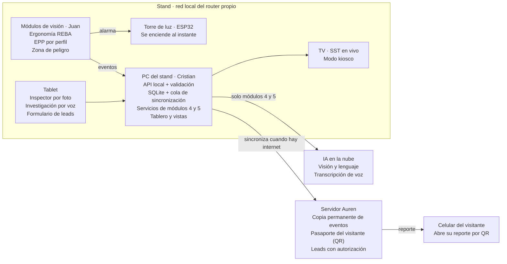

# Plataforma SST en vivo — Brief técnico

Stand de Auren Advisory · Evento UNIMINUTO Chinchiná · 11 de noviembre de 2026

---

## Contexto

UNIMINUTO Chinchiná invitó a Auren a un stand en su evento académico-empresarial del programa de Administración en Seguridad y Salud en el Trabajo (SST), en un espacio dedicado a IA aplicada a SST. Vamos a mostrar demos prácticas en vivo.

**El público.** Unos 300 estudiantes que ya trabajan como técnicos y tecnólogos de SST en empresas de la región y se están profesionalizando. No son compradores, pero son quienes llevan los problemas de SST al gerente. Conocen de memoria su trabajo diario: inspecciones, matriz de peligros (IPEVR), evaluaciones ergonómicas, investigación de incidentes.

**El objetivo comercial.** Convertirlos en prescriptores internos de Auren y salir del evento con una lista de empresas reales (sector, tamaño, problema) para ofrecer diagnósticos Auren Insight y charlas al COPASST de cada empresa.

**El gancho.** En 2025 Caldas estuvo en el top 5 de departamentos con mayor tasa de accidentalidad laboral (4,84 accidentes por cada 100 trabajadores, frente a 3,96 nacional), según el [informe de siniestralidad 2025 del Consejo Colombiano de Seguridad](https://ccs.org.co/observatorio/assets/boletin_fasecolda/6997727873dbe.pdf).

**El mensaje.** La IA hace más potente al profesional de SST, no lo reemplaza. Todo lo que la plataforma propone, una persona lo valida.

---

## La idea del producto

Una sola plataforma, "SST en vivo", con seis módulos que alimentan un tablero central. No son demos sueltas: el stand es un recorrido por el método Auren, y el tablero muestra en tiempo real todo lo que las estaciones detectan durante el evento.

- **VER** — la cámara observa el puesto de trabajo.
- **ENTENDER** — la IA convierte fotos y relatos en la documentación que el SST hace a mano.
- **TRANSFORMAR** — el tablero consolida todo en un solo sistema.

| # | Módulo | Etapa | Qué hace | Dónde corre |
|---|---|---|---|---|
| 1 | Ergonomía REBA | Ver | Estima la pose de quien levanta una caja, calcula ángulos y puntaje REBA en vivo, y genera un reporte descargable por QR | PC local (GPU) |
| 2 | EPP por perfil | Ver | Verifica el EPP que exige el perfil elegido (alimentos, alturas, ruido…) y registra el resultado | PC local (GPU) |
| 3 | Zona de peligro + torre de luz | Ver | Detecta ingreso a un perímetro virtual, enciende una torre de luz con ESP32 y registra un casi-accidente | PC local + ESP32 |
| 4 | Inspector por foto | Entender | Analiza una foto con un modelo de visión y lenguaje, propone peligros clasificados y controles, y genera filas de matriz IPEVR en Excel | Tablet → PC → API en la nube |
| 5 | Investigación por voz | Entender | Transcribe el relato de un incidente y genera un informe estructurado, análisis de causas y plan de acción | Tablet → PC → API en la nube |
| 6 | Tablero "SST en vivo" | Transformar | Consolida los eventos de todos los módulos, muestra indicadores del día y gestiona reportes y leads | PC local (servido a la TV) + servidor Auren |

Los módulos 1 a 5 los construye Juan. El módulo 6, el núcleo de la plataforma y la integración los construye Cristian. El módulo 5 es el último en prioridad: si el tiempo no alcanza, sale.

---

## Arquitectura

Local primero: la PC del stand es el servidor durante el evento, y el servidor de Auren recibe una copia cuando hay internet. Si la red del evento cae, el stand sigue funcionando completo, salvo los módulos 4 y 5.



La tablet envía fotos, audio y leads a la PC; nunca habla directo con la nube ni con el servidor.

**Por qué la visión no va en el servidor:**

- Mandar video en tiempo real por el wifi de un evento no funciona.
- La torre de luz tiene que reaccionar en milisegundos; un viaje al servidor la dejaría en segundos.
- Sin internet, el stand quedaría mudo.

**Qué aporta el servidor:** persistencia después del evento, las páginas que el visitante abre desde su celular por QR y la base de leads para el seguimiento comercial.

---

## Contrato de eventos

Todo módulo se comunica con la plataforma de una sola forma: publicando eventos con este sobre común. Es el acuerdo que permite que Cristian construya el tablero con eventos de ejemplo mientras Juan termina los módulos.

```json
{
  "id": "8f3c2a1e-5b7d-4e8a-9c21-7d4e5f6a8b90",
  "version_esquema": 1,
  "estacion": "ergonomia",
  "tipo": "evaluacion_reba",
  "timestamp": "2026-11-20T10:32:05-05:00",
  "sesion_id": "V-0142",
  "severidad": "alta",
  "datos": { "puntaje": 9, "nivel": "alto" },
  "adjuntos": [ { "tipo": "imagen", "ruta": "media/2026-11-20/8f3c2a1e.jpg" } ],
  "origen": { "dispositivo": "pc-stand", "modulo_version": "0.1.0" }
}
```

**Reglas del sobre:**

- `id`: UUID generado por el módulo que crea el evento. Hace la sincronización idempotente: si un evento llega dos veces al servidor, se guarda una vez.
- `estacion`: `ergonomia`, `epp`, `zona`, `inspector`, `incidente` o `plataforma`.
- `sesion_id`: opcional. Identifica al visitante a lo largo del recorrido (sale del QR que recibe al llegar o al primer reporte). Permite armar su "pasaporte" con todo lo que hizo en el stand.
- `severidad`: `info`, `baja`, `media`, `alta` o `critica`. El tablero la usa para colores y alertas, sin tener que conocer cada tipo.
- `datos`: libre por tipo, según la tabla de abajo.
- `adjuntos`: rutas relativas a la carpeta de medios. Las imágenes se guardan con rostros difuminados.
- `version_esquema`: sube a 2 si el sobre cambia, para no romper eventos viejos.

**Tipos de evento por módulo (versión inicial, se ajusta en el desarrollo):**

| Estación | Tipo | Campos principales en `datos` |
|---|---|---|
| ergonomia | `evaluacion_reba` | `puntaje`, `nivel`, `angulos` (tronco, cuello, brazo, antebrazo, muñeca, piernas), `duracion_s` |
| ergonomia | `reporte_generado` | `reporte_id`, `url_reporte` |
| epp | `verificacion_epp` | `perfil`, `requeridos[]`, `detectados[]`, `faltantes[]`, `cumple` |
| zona | `ingreso_zona` | `zona_id`, `duracion_s`, `alarma_activada` |
| zona | `casi_accidente` | `zona_id`, `descripcion`, `distancia_min_px` |
| inspector | `inspeccion_foto` | `escena`, `peligros[]` (peligro, clasificación, efectos, controles propuestos, nivel preliminar), `url_excel` |
| incidente | `informe_incidente` | `resumen`, `causas[]`, `acciones[]`, `url_informe` |
| plataforma | `lead_registrado` | Solo `sector` y `rango_empleados`. Nunca datos personales (ver API) |
| plataforma | `estado_modulo` | `modulo`, `estado` (activo, error, sin_conexion), `mensaje` |

`estado_modulo` es un latido: cada módulo lo emite cada 30 segundos, y así el tablero sabe qué estación está viva.

---

## API local y sincronización

La PC del stand expone una API local en la red del router propio. Los módulos y la tablet solo hablan con ella; nunca directamente con el servidor.

**Endpoints locales (propuesta):**

| Método | Ruta | Quién lo usa | Para qué |
|---|---|---|---|
| POST | `/api/eventos` | Módulos | Publicar un evento o un lote. Valida contra el esquema y responde 201 o 422 con el error |
| GET | `/api/eventos?desde=&estacion=` | Tablero | Consultar histórico del día |
| GET | `/api/stream` | Tablero | Empuje en tiempo real de eventos nuevos (SSE sugerido) |
| POST | `/api/medios` | Módulos | Subir imagen o PDF; devuelve la `ruta` para `adjuntos` |
| POST | `/api/leads` | Tablet | Registrar un lead con autorización de datos. Se guarda aparte de los eventos |
| POST | `/api/modulos/inspector` | Tablet | Enviar foto + respuestas de exposición al módulo 4 (lo atiende el servicio de Juan) |
| POST | `/api/modulos/incidente` | Tablet | Enviar audio al módulo 5 (lo atiende el servicio de Juan) |
| GET | `/api/salud` | Operador | Estado de módulos, cola de sincronización e internet |

**Sincronización con el servidor de Auren:**

1. Todo evento, medio y lead se guarda primero en la base local (SQLite) con estado `pendiente`.
2. Un proceso de fondo intenta subir lotes cada 10 segundos al servidor por HTTPS, con un token por dispositivo.
3. El servidor guarda por `id` (si llega repetido, lo ignora) y responde con los `id` aceptados.
4. La PC marca esos registros como `sincronizado`. Sin internet, la cola crece y se vacía sola cuando vuelve la conexión, con reintentos espaciados.
5. Los medios suben antes que los eventos que los referencian.

Durante el evento, la fuente de verdad es la PC. Después del evento, es el servidor.

**Los QR apuntan al servidor, no a la PC.** El visitante abre su reporte desde su celular con datos móviles, fuera de la red del stand. Si todavía no se ha sincronizado, la página dice que estará lista en unos minutos.

**Las claves de las APIs de IA viven solo en la PC.** La tablet nunca llama directamente a un servicio en la nube.

---

## Tablero principal

La plataforma tiene cuatro vistas. La más importante es la de la TV: es lo que ve todo el que pasa frente al stand.

| Vista | Dónde | Para quién | Qué muestra |
|---|---|---|---|
| TV "SST en vivo" | PC local, TV de 50" en modo kiosco | Visitantes | Indicadores del día, feed de eventos en vivo, ranking de levantamiento, estado de estaciones |
| Operador | PC local o tablet | Juan y Cristian | Eventos, errores, cola de sincronización, latidos de módulos, reintentos |
| Pasaporte del visitante `/r/{sesion_id}` | Servidor, pública por QR | Cada visitante | Sus resultados (reporte REBA en PDF, verificación EPP, Excel de inspección), formulario de contacto con autorización de datos y llamado a la acción |
| Leads | Servidor, privada | Auren | Lista de leads con sector, tamaño y problema; exportar CSV para el seguimiento |

**Indicadores de la vista TV (propuesta):**

- Personas evaluadas hoy en ergonomía y porcentaje con riesgo alto.
- Porcentaje de cumplimiento de EPP, por perfil.
- Ingresos a zona de peligro y casi-accidentes registrados.
- Peligros identificados por foto, agrupados por clasificación.
- Ranking "mejor técnica de levantamiento" del día, con alias o número de visitante, nunca nombre completo.
- Un dato fijo de contexto: Caldas, top 5 nacional en accidentalidad laboral 2025.

**Requisitos de la vista TV:**

- Un evento debe aparecer en pantalla en menos de 1 segundo.
- Legible a 3 metros en 1080p: números grandes, pocas palabras.
- Sin interacción: corre sola todo el día.
- Si un módulo cae, su tarjeta se ve en gris; el resto sigue.
- Nunca muestra rostros ni nombres.

---

## Estructura del repositorio

Un solo repositorio (monorepo) con tres zonas: la plataforma de Cristian, los módulos de Juan y el contrato que comparten. Es una propuesta; Cristian la ajusta a su forma de trabajar.

```
auren-sst/
├── contrato/                    # Fuente de verdad compartida
│   ├── evento.schema.json       # JSON Schema del sobre y de cada tipo
│   └── ejemplos/                # Un evento de ejemplo por tipo (sirven de mocks)
│
├── plataforma/                  # Cristian — Next.js + TypeScript
│   └── src/
│       ├── app/
│       │   ├── tv/              # Vista TV en modo kiosco
│       │   ├── operador/        # Vista de operación
│       │   ├── r/[sesion]/      # Pasaporte del visitante
│       │   ├── leads/           # Vista privada de leads
│       │   ├── tablet/          # Interfaz de la tablet (módulos 4 y 5, formulario)
│       │   └── api/             # Endpoints de la sección anterior
│       └── lib/
│           ├── eventos/         # Tipos y validación generados desde el contrato
│           ├── db/              # SQLite local / base del servidor
│           └── sync/            # Cola y sincronización
│
├── modulos/                     # Juan — Python
│   ├── comun/                   # Cliente compartido: publicar(evento), latido, subir_medio
│   ├── ergonomia/
│   ├── epp/
│   ├── zona/
│   │   └── firmware/            # Código del ESP32 de la torre de luz
│   ├── inspector/
│   └── incidente/
│
├── simulador/                   # Emite eventos falsos realistas para probar el tablero
└── scripts/                     # Arranque del stand con un comando, instalación, respaldo
```

**Por qué así:**

- **El contrato en su propia carpeta** evita que la plataforma y los módulos se desalineen. Si un campo cambia, cambia ahí primero.
- **El cliente Python común** hace que cada módulo de Juan solo llame `publicar(evento)`. No necesita saber nada de la base, la cola ni el servidor.
- **El simulador** desbloquea a Cristian desde el primer día: el tablero se construye y se prueba sin esperar a que exista un solo módulo real.
- **Cada módulo corre solo.** Juan puede ejecutarlo y mostrarlo por separado en su PC, fuera de la plataforma, para otros proyectos.

---

## Reparto y orden de trabajo

Primero se cierra el contrato entre los dos; después cada uno avanza en paralelo. La fecha del evento aún no está confirmada, así que el orden importa más que el calendario.

**Paso 0 — Juntos:** cerrar `contrato/evento.schema.json` y un ejemplo por tipo de evento.

**Cristian — plataforma:**

1. API local (`/api/eventos`, `/api/medios`, `/api/salud`) con validación y SQLite.
2. Simulador de eventos.
3. Vista TV con datos del simulador.
4. Sincronización con el servidor, pasaporte del visitante y leads.
5. Interfaz de tablet para los módulos 4 y 5 y el formulario.
6. Vista de operador.
7. Script de arranque del stand con un solo comando.

**Juan — módulos:**

1. Cliente Python común (`publicar`, `latido`, `subir_medio`).
2. Ergonomía REBA y EPP por perfil.
3. Inspector por foto.
4. Zona de peligro + torre de luz con ESP32.
5. Investigación por voz, si el tiempo alcanza.

**Cierre — Juntos:**

- [ ] Integración de cada módulo real con la plataforma.
- [ ] Videos de respaldo de cada demo.
- [ ] Resultados precargados de las escenas del inspector, por si no hay internet.
- [ ] Ensayo general completo, en el montaje real, con alguien que no conozca las demos.

---

## Requisitos no funcionales

**Funcionar sin internet.**

- Todo funciona sin internet excepto los módulos 4 y 5, que llaman a modelos en la nube.
- Para esos dos: hotspot 4G de respaldo y resultados precargados de las escenas preparadas.
- Llevamos router propio: la PC, la tablet y el ESP32 se hablan aunque la red del evento falle.

**Robustez.**

- Un solo script levanta la plataforma y todos los módulos.
- Si un módulo se cae, se reinicia solo y el resto sigue funcionando.

**Privacidad y datos personales.**

- Rostros difuminados en toda imagen guardada o mostrada.
- No se guarda video: solo fotogramas puntuales cuando hay un evento.
- Los leads van en una tabla aparte de los eventos, con la autorización explícita de tratamiento de datos (Ley 1581 de 2012) y enlace a la política de Auren.
- El servidor y la vista de leads exigen autenticación.

**Marca Auren** (mismos tokens del sitio web):

- Base en Auren Deep `#12343B`, Auren Black `#111414` y marfil `#F2F1EA`.
- Lima `#C8F169` solo como acento, máximo ~10 % de la pantalla, y nunca como texto sobre marfil.
- Serif solo en frases estratégicas, nunca en la interfaz.
- Nada de iconografía de IA: cerebros, circuitos, robots, hologramas, ojos.

**Honestidad del contenido.**

- Todo resultado de IA (matriz IPEVR, informe de incidente) se muestra como "borrador — validar en campo".
- La plataforma no muestra cifras de reducción de accidentes que no sean nuestras.

---

## Decisiones abiertas

Estas las define Cristian; al lado va la sugerencia de partida.

- [ ] **¿La misma app para la PC y el servidor?** Sugerencia: sí, un solo código con una variable de modo (`local` o `servidor`) que cambia la base de datos y activa o apaga la sincronización.
- [ ] **Tiempo real hacia la TV:** SSE o WebSocket. Sugerencia: SSE, porque el flujo es solo de la PC hacia la pantalla.
- [ ] **Base de datos del servidor:** la que ya use el servidor de Auren.
- [ ] **Cómo se asigna el `sesion_id`.** Sugerencia: tarjetas físicas prenumeradas con QR que el visitante recibe al llegar. Funcionan sin red y le dan un objeto para llevarse.
- [ ] **URL pública de los QR**, por ejemplo un subdominio de aurenadv.com.
- [ ] **Quién hace la interfaz de los módulos 4 y 5 en la tablet.** Sugerencia: Cristian, para que toda la plataforma se vea igual; Juan entrega los endpoints.
- [ ] **Fecha del evento y condiciones del stand** (espacio, energía, internet): pendiente de confirmar con UNIMINUTO.
